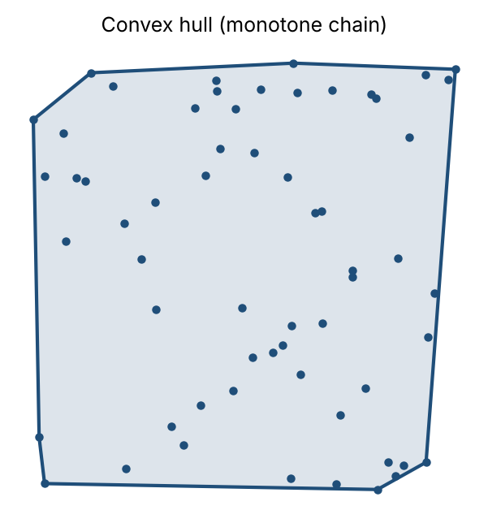
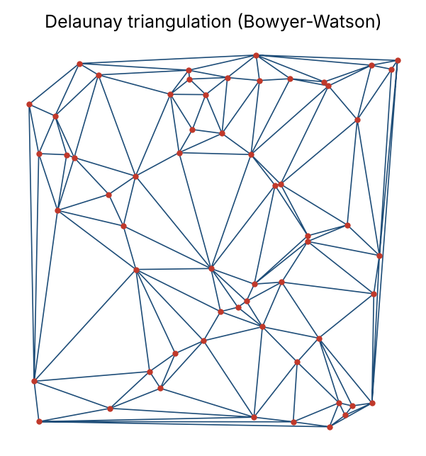
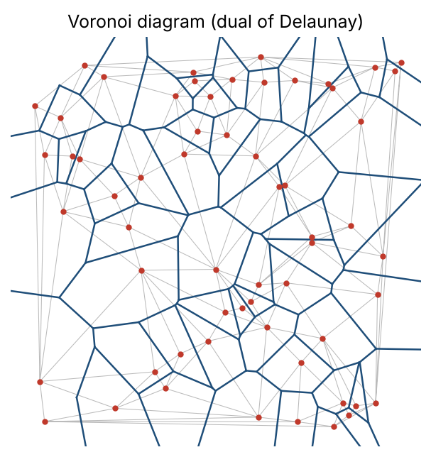
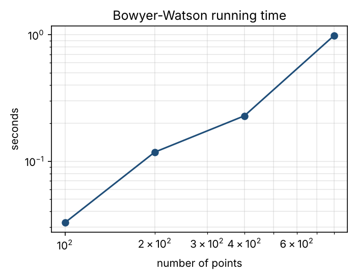

# Computational geometry in Python

Classical planar algorithms implemented from scratch with NumPy: **convex hull**, **Delaunay triangulation** and **Voronoi diagram**. Every algorithm is checked against SciPy (Qhull) on random point sets.

| Convex hull | Delaunay triangulation | Voronoi diagram |
|---|---|---|
|  |  |  |

## What is inside

| Module | Algorithm | Complexity |
|---|---|---|
| `geometry/predicates.py` | Orientation and in-circle tests as determinants | O(1) |
| `geometry/convex_hull.py` | Andrew's monotone chain | O(n log n) |
| `geometry/delaunay.py` | Bowyer–Watson incremental insertion | O(n²) worst case |
| `geometry/voronoi.py` | Voronoi diagram as the dual of Delaunay | O(n) after Delaunay |

## Key ideas

- **Predicates instead of angles.** Every decision is the sign of a determinant: *does a → b → c turn left?* and *is d inside the circle through a, b, c?* The in-circle test lifts the points to the paraboloid z = x² + y², where it becomes a plane test.
- **Delaunay = empty circumcircles.** No point lies inside the circumcircle of any triangle. Among all triangulations this maximises the minimum angle, which is why it is the standard for meshes.
- **Voronoi for free.** Voronoi vertices are the circumcentres of the Delaunay triangles, and two triangles sharing an edge give one Voronoi edge.

## Tests

```bash
pip install -r requirements.txt
python -m pytest
```

The tests check that:

- the hull and the triangulation match SciPy exactly on random inputs;
- every triangle satisfies the empty-circumcircle property;
- the number of triangles follows Euler's formula, T = 2n − h − 2 (n points, h on the hull);
- every Voronoi edge is equidistant from its two nearest sites.

## Run the demo

```bash
python demo.py
```



The simple Bowyer–Watson implementation grows roughly quadratically. Libraries such as Qhull or CGAL are much faster and use exact arithmetic to stay robust on degenerate inputs.

## Next steps

- Point location with a walking search to make insertion O(n log n) on average
- Exact (adaptive) predicates for degenerate inputs
- Constrained Delaunay triangulations and mesh refinement
